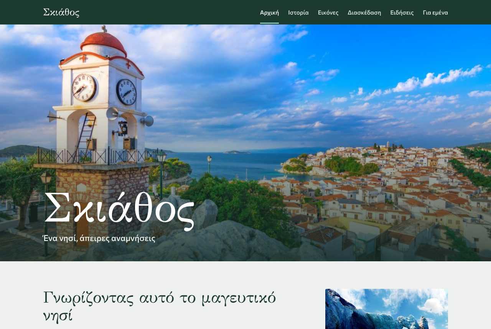
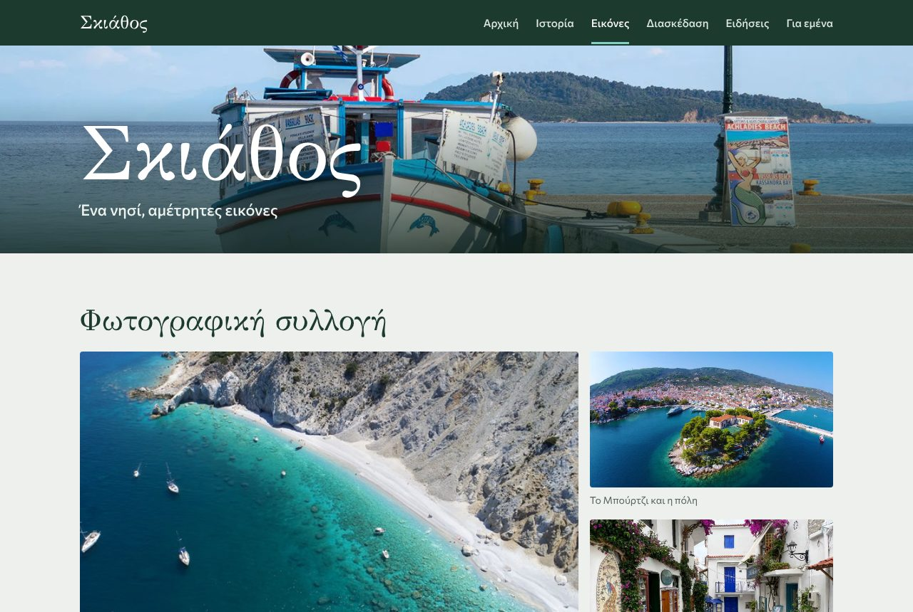
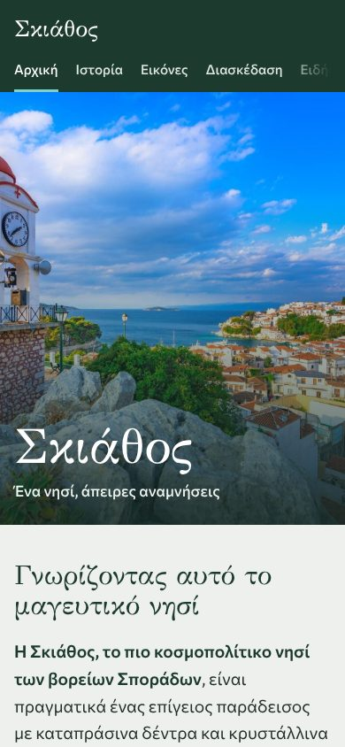

# Skiathos Guide — static website

> Ένας μικρός οδηγός για τη Σκιάθο: αξιοθέατα, ιστορία, διασκέδαση και ειδήσεις.

A small multi-page travel guide to the Greek island of **Skiathos**, written in plain **HTML5 and CSS3** (no frameworks, no JavaScript). The content is in Greek.

**Live site:** https://gianniszaf04.github.io/skiathos-site/



## Pages

| Page | What it shows |
|------|---------------|
| [`index.html`](index.html) | Introduction to the island, how to get there, map link |
| [`history.html`](history.html) | Timeline of the island's history |
| [`images.html`](images.html) | Photo gallery (click a photo to open it full size) |
| [`activities.html`](activities.html) | Beaches, sights, the famous airport landings (embedded video), water sports |
| [`news.html`](news.html) | Local news in a three-column layout with side panels |
| [`aboutme.html`](aboutme.html) | About the author, with a table of interests |

## Built with

- Semantic HTML5: `header`, `nav`, `main`, `article`, `section`, `aside`, `footer`, accessible navigation (`aria-label`, `aria-current`)
- CSS3: Flexbox and CSS Grid layouts, hover transitions, `object-fit` thumbnails, a media query for phones
- [GFS Didot](https://fonts.google.com/specimen/GFS+Didot) (headings) and [Commissioner](https://fonts.google.com/specimen/Commissioner) (text) from Google Fonts, both with Greek characters

| Gallery | Phone |
|---------|-------|
|  |  |

## Run locally

No build step. Open `index.html` in a browser, or serve the folder:

```bash
python3 -m http.server 8000
```

then go to <http://localhost:8000>.

## Notes

This was a university assignment for a Web Programming course (University of Thessaly, 2025).

Photos and the two advertisement images belong to their respective owners and are used here for educational, non-commercial purposes only. News texts are summaries of local news from November 2025.

## Author

**Ioannis Zafeiris**
